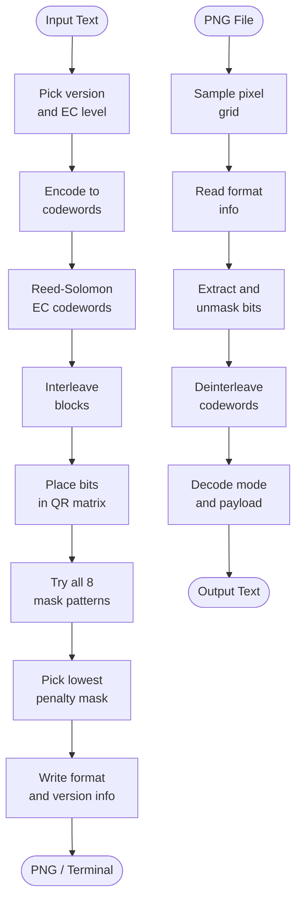

<div align="center">

# QR Code

**QR code generator and decoder written from scratch in Rust**

[](https://www.rust-lang.org)
[](https://crates.io/crates/image)
[](LICENSE)

</div>

## Background

I wrote this about a year ago when I was learning Rust. It had a lot of bugs and wrong bit placements, so I got AI to help track them down and rewrite/fix them. The core algorithms, the GF(256) tables, the Reed-Solomon logic, and the zig-zag placement are all mine. But I have gotten AI to refactor them so they work a lot better. The AI mostly fixed off-by-one errors in the separator and boundary handling.

## What it does

Encodes text into a QR code and saves it as a PNG or prints it in the terminal. Can also decode any QR PNG it produced back to the original text. No external QR library is used at all. The `image` crate is only used to read and write raw pixels.

Supports versions 1 through 10 (up to 271 bytes at L level), all four error correction levels, byte mode for arbitrary text, and numeric mode for digit-only strings.

## How it works



## Algorithms

| Stage | Detail |
|---|---|
| Error correction | Reed-Solomon over GF(256), irreducible polynomial 0x11D |
| Format info | BCH(15,5), generator 0x537, XOR mask 0x5412 |
| Version info | BCH(18,6), generator 0x1F25 |
| Masking | All 8 patterns evaluated, lowest penalty score wins |
| Encoding modes | Byte (any UTF-8) and Numeric (digits only) |

## Performance

Measured on release build, warm run (excluding first cold start), single core. Times include PNG write to disk.

| Input | Version | Grid | Warm time |
|---|---|---|---|
| `HELLO WORLD` | 1 | 21x21 | ~30 ms |
| `https://github.com/Rijzzz/qr-code` | 3 | 29x29 | ~22 ms |
| 100 byte payload | 6 | 41x41 | ~29 ms |
| 271 byte payload (v10 L max) | 10 | 57x57 | ~26 ms |

Most of that time is process startup and PNG write, not the QR algorithm itself.

## Quick start

```bash
cargo build --release

./target/release/qr "Hello, World!" --out hello.png
./target/release/qr "12345678" --ec L --out digits.png --scale 12
./target/release/qr "Some text" --terminal
./target/release/qr --decode hello.png
./target/release/qr --test
```

### Options

| Flag | Default | What it does |
|---|---|---|
| `--ec L\|M\|Q\|H` | M | Error correction level |
| `--out file.png` | none | Save QR as PNG |
| `--scale N` | 10 | Pixels per module |
| `--terminal` | off | Print QR in terminal |
| `--decode file.png` | | Decode a QR PNG back to text |
| `--test` | | Run encode/decode round-trip tests |

## Error correction levels

| Level | Recovery | Best for |
|---|---|---|
| L | 7% | Clean digital environments |
| M | 15% | General use (default) |
| Q | 25% | Printed materials |
| H | 30% | Stickers, signs, damage-prone surfaces |

## Data capacity at version 10

These are the actual limits confirmed by running the encoder.

| EC level | Byte mode | Numeric mode |
|---|---|---|
| L | 271 bytes | 271 chars |
| M | 213 bytes | 213 chars |
| Q | 151 bytes | 151 chars |
| H | 119 bytes | 119 chars |

## Structure

```
src/
  main.rs    CLI and dispatch
  encode.rs  GF(256), Reed-Solomon, data codewords, block interleaving
  matrix.rs  QR matrix, masking, penalty scoring, PNG and terminal output
  decode.rs  Grid sampling, format reading, codeword decoding
```

## Notes

The decoder works on axis-aligned PNGs with a quiet zone of exactly 4 modules. It does not handle rotation or perspective distortion, so it only reliably decodes images produced by this same encoder.
